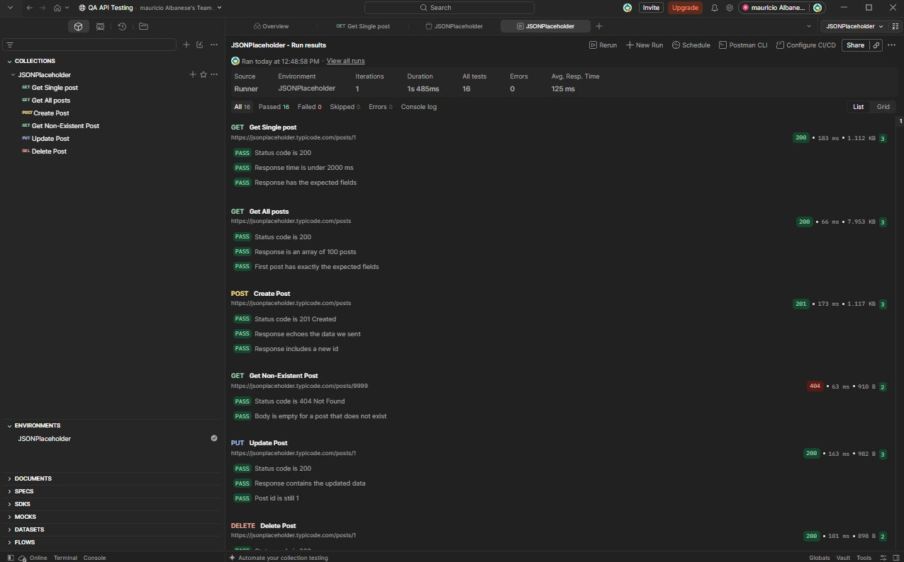

# API Testing with Postman: JSONPlaceholder

Functional API tests for the JSONPlaceholder fake REST API.

## What is covered
| Request | Method | What it validates |
|---------|--------|-------------------|
| Get Single Post | GET | Status 200, response time, expected fields |
| Get All Posts | GET | Array of 100 posts, structure of each item |
| Create Post | POST | Status 201, response echoes sent data |
| Update Post | PUT | Status 200, updated values returned |
| Delete Post | DELETE | Status 200, empty body |
| Get Non-Existent Post | GET | Negative case: status 404 |

## How to run
1. Import `postman/jsonplaceholder-collection.json` into Postman
2. Import `postman/jsonplaceholder-environment.json` and select it
3. Run the collection with the Collection Runner

## Results

## Notes
JSONPlaceholder simulates write operations (POST, PUT, DELETE) and does not persist data.